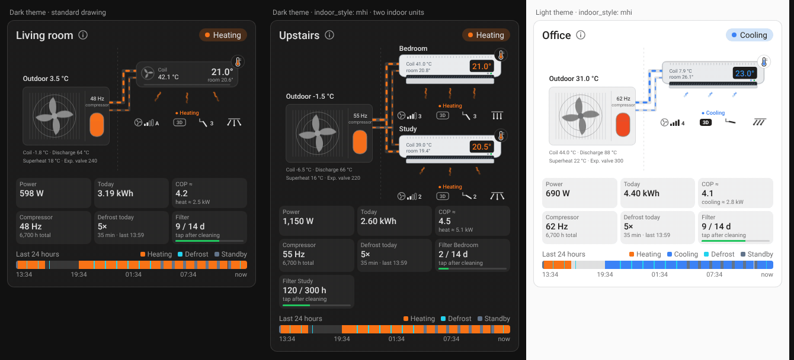

# Airco Heat Pump Card

Animated Home Assistant card for **air-to-air heat pumps** (split airco).
Works with any air-to-air heat pump in Home Assistant: pick the sensors in the visual editor.
With [MHI-AC-Ctrl](https://github.com/ginkage/MHI-AC-Ctrl-ESPHome) (ESPHome) the card finds them by itself.



## Features

- **Outdoor unit** with a spinning fan and a compressor that shakes while it runs.
- **Refrigerant flow** between outdoor and indoor unit. It reverses when cooling or defrosting.
- **Defrost**: the outdoor coil frosts over, a snowflake appears and the refrigerant turns icy blue.
- **Indoor units** with a spinning fan and air streaks that follow fan speed and vane position (swing included).
- **Temperatures**: outdoor air, outdoor coil, discharge gas, superheat, expansion valve, indoor coil, room and setpoint.
- **Tiles**: power, energy today, estimated COP, compressor, defrosts today and filter counters.
- **Timeline** of the last 24 hours.
- **Two indoor units on one outdoor unit** (multi-split).
- **Visual editor** that shows which sensors were found automatically.
- **Built-in explanation**: the ⓘ button opens a short explanation of the colors and the drawing inside the card.
- **Thermostat button** on every indoor unit opens the climate controls.
- English labels by default; Dutch (`language: nl`) is available as a translation.

## Installation

### HACS / Marketplace

1. Add `https://github.com/sanderlv/airco-heatpump-card` as a custom repository, type **Dashboard**.
2. Install **Airco Heat Pump Card** and reload the browser.

### Manual

1. Download `airco-heatpump-card.js` from the [latest release](https://github.com/sanderlv/airco-heatpump-card/releases/latest) and copy it to `/config/www/`.
2. Add the resource `/local/airco-heatpump-card.js` as a **JavaScript module**
   (Settings → Dashboards → ⋮ → Resources).

## Setup

Edit a dashboard → **Add card** → search for **Airco Heat Pump Card**.

1. Pick the **climate entity** of your indoor unit. That is the only required field.
2. Open **Indoor unit sensors** and **Outdoor unit sensors**. Under every empty field the editor shows
   which sensor it found automatically, or *Not found automatically*. Pick the missing ones yourself.
3. Optional: a **filter helper** (see [Filter counter](#filter-counter)), a second indoor unit, language and animations.

Everything can also be set in YAML, see [Configuration](#configuration).

## Reading the card

Tap the **ⓘ** button next to the title for a short version of this explanation inside the card.

### Colors


The same color is used for the status chip, the air streaks, the refrigerant lines and the timeline.

| Color | Status | What the unit is doing |
| --- | --- | --- |
| Orange | Heating | Heat mode, compressor running. |
| Blue | Cooling | Cool mode, compressor running. |
| Teal | Drying | Dry mode, compressor running. |
| Purple | Auto | Auto mode (heat/cool) and the card cannot tell which of the two. In the timeline, auto mode is always purple. |
| Light grey | Fan only | Fan mode: only the indoor fan runs. |
| Dark grey | Standby | The unit is on, but the compressor stands still, usually because the room has reached the setpoint. The indoor fan may still run slowly. |
| Cyan | Defrost | The outdoor unit is melting frost off its coil (see below). |

### Air streaks under the indoor unit

- **Color**: the status, see the table above.
- **Speed**: follows the indoor fan speed. Faster streaks = more air.
- **Direction**: follows the vane position, from almost horizontal to straight down. With swing, the streaks sweep up and down.
- **No streaks**: the indoor fan stands still. That happens when the unit is off, and during defrost
  (the indoor fan stops so no cold air blows into the room).

### Refrigerant lines

- The **thick line** is the gas line, the **thin line** is the liquid line.
- The dashes only move while the compressor runs, and move faster at a higher compressor frequency.
- **Heating**: hot gas flows from the outdoor unit through the thick line to the indoor unit, where it releases its heat.
  The liquid flows back through the thin line.
- **Cooling and defrost**: the flow reverses.

### Outdoor unit

- The **fan** follows the outdoor fan speed. It stops during defrost.
- The **compressor** shakes while it runs. The number above it is its frequency in Hz: higher = more power.
- **Outdoor**: air temperature measured by the outdoor unit. Sun or a running unit can make it read a little high.
- **Coil**: temperature of the outdoor heat exchanger. When heating it is colder than the outdoor air.
  Below 0 °C, moisture from the air freezes on it.
- **Discharge**: temperature of the hot gas leaving the compressor.
- **Superheat**: discharge superheat as reported by the unit.
- **Exp. valve**: opening of the electronic expansion valve, in pulses. Higher = more open.

#### Defrost

When heating in cold, damp weather, frost builds up on the outdoor coil and blocks the airflow.
The unit then reverses the refrigerant flow for a few minutes so hot gas melts the frost.
During that time the card shows the frosted coil, the snowflake and cyan lines, and the indoor fan stops.
A defrost every hour or so around 0 °C with high humidity is normal. Each one costs some energy,
so many long defrosts lower the efficiency.

### Indoor unit

- **Big number**: room temperature, measured in the air the unit sucks in.
- **Target**: the setpoint. When the unit is off, its status is shown instead.
- **Coil**: temperature of the indoor heat exchanger. When heating it is well above room temperature,
  when cooling well below.

### Tiles

| Tile | Shows |
| --- | --- |
| Power | Electrical power of the outdoor unit. From a power sensor, or current × `voltage`. |
| Today | Energy used today. |
| COP ≈ | Estimated efficiency: delivered heat (or cooling) ÷ electrical power, with the estimated heat in kW below it. Shows `–` while the compressor stands still and during defrost. See [About the COP](#about-the-cop). |
| Compressor | Compressor frequency now, with total compressor run hours below it. |
| Defrost today | Number of defrosts since midnight, total minutes and start time of the last one. |
| Filter | Days (or run hours) since the filter was cleaned, against the interval. The bar turns orange at 80 % and red when cleaning is due. |

### Timeline

The bar under the tiles shows the status of the last 24 hours, in the colors above.
The dark background means the unit was off. Hover over a block to see its times.

### Notices

A notice appears under the title when the unit reports something:

- **Amber**: a *protection control* (for example *Low pressure protection control* or *Discharge pipe temperature
  protection control*). The unit limits itself for a while to protect the compressor. In cold weather this is usually normal.
- **Red**: a fault: an **error code**, or a protection state like *... anomaly*, *Current cut* or *Stop by ...*.

### Tapping

- **Thermostat button** (the round button with a thermometer on the corner of every indoor unit): opens the
  climate dialog, so you can control the unit. Its thermometer has the color of the unit's status.
  Tapping the indoor unit itself, the title or the status chip does the same.
- **ⓘ button**: shows or hides the explanation of the colors and the drawing.
- **Any other part of the drawing, and the tiles**: opens the history of that sensor.
- **Filter tile**: resets the filter counter after cleaning (asks for confirmation).

## Configuration

The visual editor writes this YAML for you. You can also write it by hand.

### One indoor unit

```yaml
type: custom:airco-heatpump-card
entity: climate.living_room
```

### With filter counter

```yaml
type: custom:airco-heatpump-card
name: Living room
indoor:
  - climate: climate.living_room
    filter: input_datetime.living_room_airco_filter
    filter_days: 14
```

### Two indoor units on one outdoor unit

```yaml
type: custom:airco-heatpump-card
name: Outdoor unit 2
indoor:
  - climate: climate.bedroom
    name: Bedroom
  - climate: climate.study
    name: Study
```

The outdoor values (compressor, defrost, power, ...) are read from the **first** indoor unit.

### Options

| Option | Default | Description |
| --- | --- | --- |
| `entity` | | Climate entity (shortcut for one indoor unit). |
| `indoor` | | List of indoor units (max 2), see below. |
| `name` | friendly name | Card title. |
| `language` | `auto` | `auto`, `en` or `nl`. |
| `animations` | `auto` | `auto` follows the "reduce motion" setting of your device, `always` or `off`. |
| `cop` | `true` | Show the estimated COP tile. |
| `coil_factor` | `0.7` | Share of the coil-to-room temperature difference that ends up in the air (COP estimate). |
| `timeline` | `true` | Show the timeline. |
| `timeline_hours` | `24` | Hours shown in the timeline. |
| `help` | `true` | Show the ⓘ button with the explanation. |
| `voltage` | `230` | Used to turn amps into watts when there is no power sensor. |
| `entities` | | Outdoor unit sensors, see below. |

Per indoor unit:

| Option | Description |
| --- | --- |
| `climate` | Climate entity (required). |
| `name` | Name shown in the drawing (only with two indoor units). |
| `filter` | `input_datetime` (counts days) or `input_number` (counts run hours). |
| `filter_days` / `filter_hours` | Interval before the filter needs cleaning (default 30 days / 300 hours). |
| `airflow` | Airflow in m³/h per indoor fan speed, from the datasheet. See [Airflow from the datasheet](#airflow-from-the-datasheet). |
| `entities` | Indoor unit sensors, see below. |

### Sensors

Sensors that are not found automatically (or belong to another brand) can be set by hand:

```yaml
entities:          # outdoor unit
  defrost: binary_sensor.my_defrost
  compressor: sensor.my_compressor_frequency
  power: sensor.my_power
indoor:
  - climate: climate.my_airco
    entities:      # this indoor unit
      room: sensor.my_room_temperature
```

| Outdoor key | Sensor |
| --- | --- |
| `defrost` | Defrost active (binary sensor) |
| `outdoor_temp` | Outdoor air temperature |
| `compressor` | Compressor frequency (Hz) |
| `outdoor_fan` | Outdoor fan speed |
| `outdoor_coil` | Outdoor coil temperature |
| `discharge` | Discharge gas temperature |
| `superheat` | Discharge superheat |
| `exp_valve` | Expansion valve opening |
| `protection` | Compressor protection status |
| `compressor_hours` | Compressor run hours |
| `power` | Power (W) |
| `current` | Current (A), used when there is no power sensor |
| `energy_today` | Energy used today |

| Indoor key | Sensor |
| --- | --- |
| `room` | Room (return air) temperature |
| `indoor_fan` | Indoor fan speed |
| `coil1`, `coil2`, `coil3` | Indoor coil temperatures (MHI: U-bend, capillary, suction header) |
| `run_hours` | Indoor run hours |
| `vanes` | Vane position (1–4, 5 = swing) |
| `error` | Error code |

`energy_today` is only found automatically when its entity_id ends in `_energy_today` or `_daily_energy`.

## Filter counter

The card can remind you to clean the air filter of every indoor unit. Each indoor unit needs one helper that stores
the date its filter was last cleaned.

### 1. Create a helper

Settings → Devices & services → **Helpers** → **Create helper** → **Date and/or time**:

- **Name**: for example `Living room airco filter`. This gives the entity `input_datetime.living_room_airco_filter`.
- Choose **Date**. A time is not needed.
- Optional icon: `mdi:air-filter`.

Open the new helper and set the date the filter was last cleaned (today, if you just cleaned it).
Until the helper has a date, the card hides the filter tile.

With two indoor units on one card, create a helper for each of them.

### 2. Link it to the indoor unit

In the card editor: **Indoor unit** → **Filter helper** → pick the helper, then set **Clean filter every (days)**.

Or in YAML:

```yaml
type: custom:airco-heatpump-card
indoor:
  - climate: climate.living_room
    filter: input_datetime.living_room_airco_filter
    filter_days: 14
```

### 3. Use it

- The tile shows the days since cleaning against the interval, for example `9 / 14 d`.
- The bar is green, turns orange at 80 % of the interval and red when cleaning is due. Then the tile says *clean filter*.
- After cleaning the filter, **tap the filter tile** and confirm. The card sets the helper to today and the counter starts at 0 again.
- With two indoor units, each unit has its own tile, named after the unit (for example *Filter Bedroom*).

### How often?

Mitsubishi Heavy Industries' user manuals advise to clean the air filter **at least every two weeks** during the
heating and cooling season: a clogged filter reduces airflow and efficiency. For a unit that runs little,
30 days is reasonable. Extra filters (allergen, deodorizing) have their own interval: see the manual of your unit.
The card's default interval is 30 days; set `filter_days: 14` to follow the manual.

### Reminder automation (optional)

The helper can also be used in an automation, for example a daily notification when the filter is due:

```yaml
alias: Airco filter reminder
triggers:
  - trigger: time
    at: "18:00:00"
conditions:
  - condition: template
    value_template: >
      {{ (now().timestamp() - state_attr('input_datetime.living_room_airco_filter', 'timestamp')) / 86400 >= 14 }}
actions:
  - action: notify.notify
    data:
      message: Time to clean the air filter of the living room airco.
```

### Run hours instead of days

Instead of a date helper you can use a **Number** helper (`input_number`, minimum 0, maximum 100000, step 1)
with `filter_hours` instead of `filter_days`. The card then counts the indoor unit's run hours since cleaning,
and tapping the tile stores the current run hours in the helper. MHI-AC-Ctrl reports run hours in steps of 100 h,
so for those units the date helper is more precise.

## About the COP

An air-to-air unit does not measure the heat it delivers, so the COP is an **estimate** (shown with ≈):

```text
heat = airflow × air density × heat capacity × (coil temperature − room temperature) × coil_factor
COP  = heat / electrical power
```

The airflow per fan speed comes from `airflow` (default 300–660 m³/h). When cooling, only the temperature drop is counted,
not the water taken out of the air, so cooling is underestimated. At low compressor speed the difference between coil and
room is small, so the estimate is least reliable there. Treat the number as a trend, not a measurement.

### Airflow from the datasheet

`airflow` is a list with one value (m³/h) per value of the indoor fan speed sensor: the first value is used at fan speed 1,
the second at fan speed 2, and so on. Speeds above the end of the list use the last value.

MHI-AC-Ctrl reports the indoor fan speed as 0–7: 0 = off, **2 = ULo, 3 = Lo, 4 = Me, 5 = Hi**
(1 to 4 bars on the remote), and up to 7 in auto mode. Datasheets give the airflow in m³/min: multiply by 60.

Example for an SRK35ZS (heating: ULo 5.6, Lo 7.0, Me 11.0, Hi 12.3 m³/min):

```yaml
indoor:
  - climate: climate.living_room
    airflow: [336, 336, 420, 660, 738]   # fan speed 1, 2 (ULo), 3 (Lo), 4 (Me), 5 (Hi) and higher
```

## Troubleshooting

| Problem | Solution |
| --- | --- |
| The card is not in the card picker after installing | Reload the browser (clear the cache if needed). |
| Timeline empty or defrost counter shows `–` | The card reads the history from the recorder. Make sure the defrost, compressor frequency and climate entities are not excluded from the recorder. |
| Nothing moves | Your device has "reduce motion" turned on. Set **Animations** to **Always**. |
| The filter tile is missing | No filter helper is set for the indoor unit, or the helper has no date yet. See [Filter counter](#filter-counter). |
| A value shows `–` | The sensor was not found or is unavailable. Pick it in the editor under the sensors sections. |
| Power shows a wrong value with two indoor units | Outdoor values come from the first indoor unit. Put the unit whose sensors measure the outdoor unit first, or set `power` under `entities`. |

## Versions

The card uses [semantic versioning](https://semver.org). Every version is a GitHub release,
so HACS shows when an update is available. What changed per version is in [CHANGELOG.md](CHANGELOG.md).
The version of the loaded card is printed in the browser console.

### Releasing a new version

1. Raise `CARD_VERSION` at the top of `airco-heatpump-card.js`.
2. Add a section for that version to `CHANGELOG.md`.
3. Commit and push.
4. On GitHub: **Releases → Draft a new release**, create tag `v0.2.0` on `main`, title `v0.2.0`, **Publish release**.

The release workflow then checks that the tag matches `CARD_VERSION`, fills the release notes
from `CHANGELOG.md` and attaches `airco-heatpump-card.js` to the release.

## License

MIT
