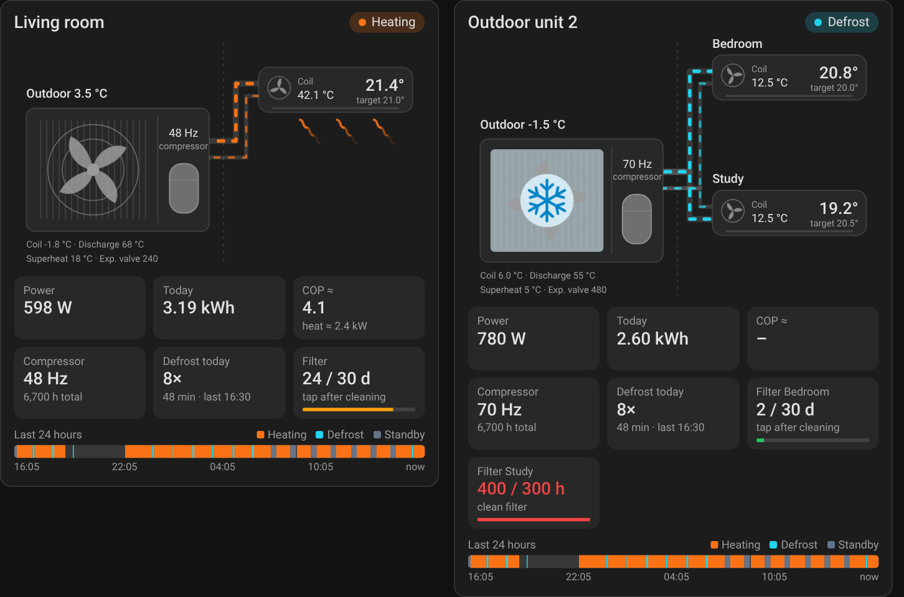

# Airco Heat Pump Card

Animated Home Assistant card for **air-to-air heat pumps** (split airco).
Made for units read out with [MHI-AC-Ctrl](https://github.com/ginkage/MHI-AC-Ctrl-ESPHome) (ESPHome),
but every entity can be set by hand, so other brands work too.



## What it shows

- **Outdoor unit** with a spinning fan (speed follows the outdoor fan sensor) and a humming compressor (follows the compressor frequency).
- **Refrigerant flow** between outdoor and indoor unit. Hot gas goes to the indoor unit when heating; the flow reverses when cooling or defrosting.
- **Defrost**: the outdoor coil frosts over, a snowflake appears and the refrigerant turns icy blue.
- **Indoor unit(s)** with a spinning fan and air streaks that follow fan speed and vane position (swing included).
- **Temperatures**: outdoor air, outdoor coil, discharge gas, superheat, expansion valve, indoor coil, room and setpoint.
- **Tiles**: power, energy today, estimated COP, compressor, defrosts today (count, minutes, last start) and filter counters.
- **Timeline** of the last 24 hours: heating, cooling, defrost and standby.
- **Two indoor units on one outdoor unit** (multi-split).
- English labels by default; Dutch (`language: nl`) is available as a translation.

Tap any part of the drawing or a tile to open the history of that sensor.

## Installation

### HACS / Marketplace

1. Add `https://github.com/sanderlv/airco-heatpump-card` as a custom repository, category **Dashboard**.
2. Install **Airco Heat Pump Card** and reload the browser.

### Manual

1. Copy `airco-heatpump-card.js` to `/config/www/`.
2. Add the resource `/local/airco-heatpump-card.js` as a **JavaScript module**
   (Settings → Dashboards → ⋮ → Resources).

## Configuration

### One indoor unit (simplest)

```yaml
type: custom:airco-heatpump-card
entity: climate.living_room
```

With MHI-AC-Ctrl that is all you need: the card finds the other sensors of the same device by itself.

### With filter counter

```yaml
type: custom:airco-heatpump-card
name: Living room
indoor:
  - climate: climate.living_room
    filter: input_datetime.living_room_filter
    filter_days: 30
```

### Two indoor units on one outdoor unit

```yaml
type: custom:airco-heatpump-card
name: Outdoor unit 2
indoor:
  - climate: climate.bedroom
    name: Bedroom
  - climate: climate.study
    name: Study
```

The outdoor values (compressor, defrost, power, ...) are read from the **first** indoor unit.

### Options

| Option | Default | Description |
| --- | --- | --- |
| `entity` | | Climate entity (shortcut for one indoor unit). |
| `indoor` | | List of indoor units (max 2), see below. |
| `name` | friendly name | Card title. |
| `language` | `auto` | `auto`, `nl` or `en`. |
| `animations` | `auto` | `auto` follows the "reduce motion" setting of your device, `always` or `off`. |
| `cop` | `true` | Show the estimated COP tile. |
| `coil_factor` | `0.7` | Part of the coil-to-room temperature difference that ends up in the air (used for the COP estimate). |
| `timeline` | `true` | Show the timeline. |
| `timeline_hours` | `24` | Hours shown in the timeline. |
| `voltage` | `230` | Used to turn amps into watts when there is no power sensor. |
| `entities` | | Override any outdoor entity, see below. |

Per indoor unit:

| Option | Description |
| --- | --- |
| `climate` | Climate entity (required). |
| `name` | Name shown in the drawing. |
| `filter` | `input_datetime` (counts days) or `input_number` (counts run hours). |
| `filter_days` / `filter_hours` | Interval before the filter needs cleaning (default 30 days / 300 hours). |
| `airflow` | Airflow in m³/h per indoor fan speed, e.g. `[300, 400, 500, 600]` (from the datasheet). |
| `entities` | Override any indoor entity, see below. |

### Entity keys

If a sensor is not found automatically (or you use another brand), set it yourself:

```yaml
entities:          # outdoor unit
  defrost: binary_sensor.my_defrost
  compressor: sensor.my_compressor_frequency
  power: sensor.my_power
indoor:
  - climate: climate.my_airco
    entities:      # this indoor unit
      room: sensor.my_room_temperature
```

Outdoor: `defrost`, `outdoor_temp`, `compressor`, `outdoor_fan`, `outdoor_coil`, `discharge`, `superheat`,
`exp_valve`, `protection`, `compressor_hours`, `power`, `current`, `energy_today`.

Indoor: `room`, `indoor_fan`, `coil1`, `coil2`, `coil3`, `run_hours`, `vanes`, `error`.

`energy_today` is only found automatically when its entity_id ends in `_energy_today` or `_daily_energy`
(for example a Utility Meter helper on the same device). Otherwise set it under `entities`.

## Filter counter

Create a helper (Settings → Devices & services → Helpers):

- **Date and/or time** (`input_datetime`): the card shows the days since cleaning. Recommended.
- **Number** (`input_number`, max e.g. 100000): the card shows the indoor run hours since cleaning.
  Note that MHI-AC-Ctrl reports run hours in steps of 100 h.

After cleaning the filter, tap the filter tile and confirm. The card writes the current date (or run hours) to the helper.

## About the COP

An air-to-air unit does not measure the heat it delivers, so the COP is an **estimate** (shown with ≈):

```text
heat = airflow × air density × heat capacity × (coil temperature − room temperature) × coil_factor
COP  = heat / electrical power
```

The airflow per fan speed comes from `airflow` (default 300–660 m³/h). Treat the number as a trend, not a measurement.

## Versions

The card uses [semantic versioning](https://semver.org). Every version is a GitHub release,
so HACS shows when an update is available. What changed per version is in [CHANGELOG.md](CHANGELOG.md).
The version of the loaded card is printed in the browser console.

### Releasing a new version

1. Raise `CARD_VERSION` at the top of `airco-heatpump-card.js`.
2. Add a section for that version to `CHANGELOG.md`.
3. Commit and push.
4. On GitHub: **Releases → Draft a new release**, create tag `v0.2.0` on `main`, title `v0.2.0`, **Publish release**.

The release workflow then checks that the tag matches `CARD_VERSION`, fills the release notes
from `CHANGELOG.md` and attaches `airco-heatpump-card.js` to the release.

## License

MIT
